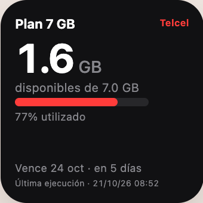
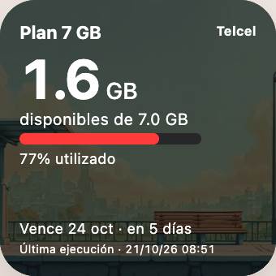
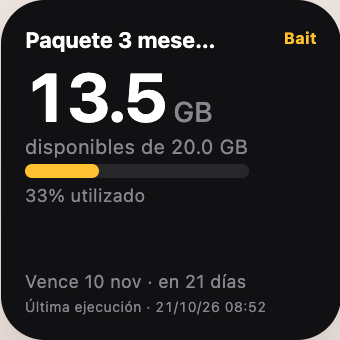
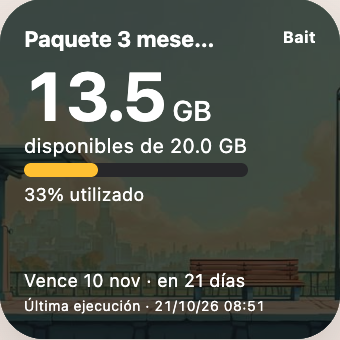

> [!NOTE]
> Para ver la versión en español, [haz clic aquí](README.es.md).

# Mobile Data Tracker

Check your Telcel or Bait mobile data usage from your home screen. Choose a
solid-color or image-background widget, copy one script into Scriptable, and
connect directly to your carrier.

## Get started

Not sure how to configure a script? **[Create your widget visually](https://gabri3l0.github.io/mobile-data-tracker/widgets/previews/)**: choose your carrier, adjust the background, and generate the complete code to paste into Scriptable.

Open the **[widget guide](widgets/README.md)** to choose your script and install
it on your iPhone. It also covers customization, refresh behavior, and debugging.
No server or computer is needed.

## Preview

Click a screenshot to open the generator with that carrier and design selected.

| Carrier | Solid color | Background image | Get code |
| --- | :---: | :---: | --- |
| Telcel |  |  | [Telcel widgets](widgets/telcel/) |
| Bait |  |  | [Bait widgets](widgets/bait/) |

## Widget features

- Remaining data and a usage progress bar.
- Telcel balances displayed in the carrier’s MB or GB unit.
- Plan name, expiration date, and days remaining.
- Account details stored in iOS Keychain.
- Dark, light, and custom themes with text and accent colors.
- Solid or image backgrounds with bar, semicircle, or chart-free layouts.
- Saved readings available when updates fail.
- One timestamp showing when the script last ran.
- New-release notices with a link to the matching widget generator.

## Optional central server

The Python CLI and API provide usage readings for both carriers, with API keys
and limits per person. Family-account tracking, daily consumption, history, and
trends are future goals.

See the **[server guide](server/README.md)** for setup, CLI commands, and endpoints.

## License

[MIT](LICENSE): use, modify, and redistribute the code, including commercially,
while keeping the copyright and license notice. The software comes without warranty.
Third-party images and assets retain their respective licenses.

## Disclaimer

This project is unofficial and is not affiliated with, endorsed by, or sponsored by the carrier.
Use only accounts you own or are authorized to access, and comply with applicable laws and carrier terms.
Personal account credentials, session tokens, and proprietary carrier software are not distributed with this project.
