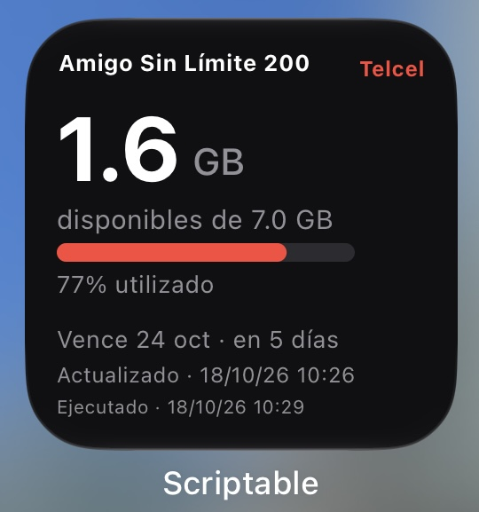
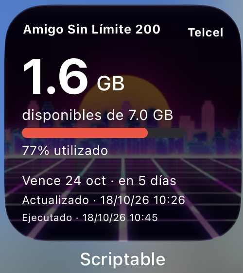
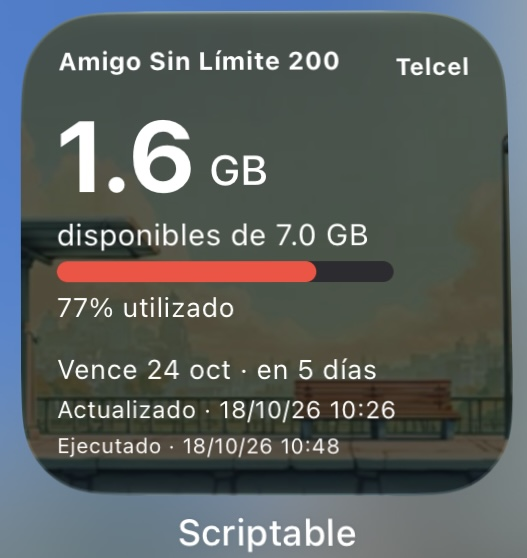

# Mobile Data Tracker

Track mobile data usage with two components:

- [Widgets](widgets/README.md): Scriptable widgets for iPhone showing remaining data,
  plan expiration, and the latest reading on your home screen. They currently use
  the server; direct carrier access is planned.
- [Central server](server/README.md): Python API and CLI for current usage, with the
  longer-term purpose of tracking family accounts, daily consumption, history, and
  trends. Those account-management and analytics features are not implemented yet.

The central server supports Telcel and Bait.

## Preview

| Dark | Image 1 | Image 2 |
| :---: | :---: | :---: |
|  |  |  |
| [Open Dark preview](https://gabri3l0.github.io/mobile-data-tracker/widgets/dark/preview.html) | [Open Image 1 preview](https://gabri3l0.github.io/mobile-data-tracker/widgets/image/preview.html) | [Open Image 2 preview](https://gabri3l0.github.io/mobile-data-tracker/widgets/image/preview.html) |

## Features

- Remaining and used data, with a usage progress bar.
- Plan name, expiration date, and days remaining.
- Dark and customizable image-background widgets.
- Cached readings available when updates fail.
- Separate timestamps for usage readings and script execution.
- Bearer-protected API with limits per person.
- CLI access and browser previews.

## Guides

- [Central server](server/README.md) — setup, CLI, API, authentication, and tests.
- [iPhone widgets](widgets/README.md) — designs, Scriptable setup, and refresh behavior.

Run Python commands from `server/` and keep local configuration in `server/.env`.

## License

[MIT](LICENSE): use, modify, and redistribute the code, including commercially,
while keeping the copyright and license notice. The software comes without warranty.
Third-party images and assets retain their respective licenses.

## Disclaimer

This project is unofficial and is not affiliated with, endorsed by, or sponsored by the carrier.
Use only accounts you own or are authorized to access, and comply with applicable laws and carrier terms.
No credentials, tokens, or proprietary carrier software are distributed with this project.
