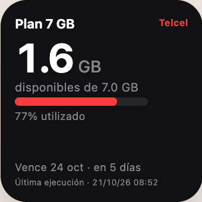
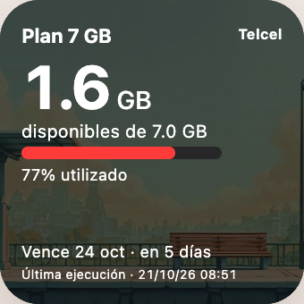
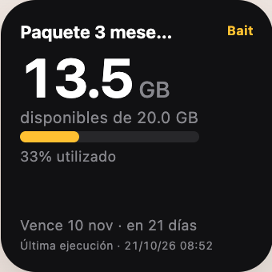
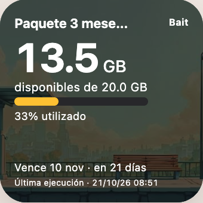

[English](README.md) | Español

# Widgets de datos móviles

Consulta tus datos restantes y la vigencia de tu paquete desde la pantalla de inicio.
Cada widget consulta directamente a Telcel o Bait: copia un solo script, sin servidor
ni computadora. Android aún no es compatible.

| Operador | Diseño | Vista previa | Script | Personalizar | Generar código |
| --- | --- | --- | --- | --- | --- |
| Telcel | Color sólido | [](https://gabri3l0.github.io/mobile-data-tracker/widgets/previews/?design=solid&carrier=telcel) | [solid.js](telcel/solid.js) | [Ajustes](#personalizar) | [Crear widget](https://gabri3l0.github.io/mobile-data-tracker/widgets/previews/?design=solid&carrier=telcel) |
| Telcel | Imagen de fondo | [](https://gabri3l0.github.io/mobile-data-tracker/widgets/previews/?design=image&carrier=telcel) | [image.js](telcel/image.js) | [Ajustes](#personalizar) | [Crear widget](https://gabri3l0.github.io/mobile-data-tracker/widgets/previews/?design=image&carrier=telcel) |
| Bait | Color sólido | [](https://gabri3l0.github.io/mobile-data-tracker/widgets/previews/?design=solid&carrier=bait) | [solid.js](bait/solid.js) | [Ajustes](#personalizar) | [Crear widget](https://gabri3l0.github.io/mobile-data-tracker/widgets/previews/?design=solid&carrier=bait) |
| Bait | Imagen de fondo | [](https://gabri3l0.github.io/mobile-data-tracker/widgets/previews/?design=image&carrier=bait) | [image.js](bait/image.js) | [Ajustes](#personalizar) | [Crear widget](https://gabri3l0.github.io/mobile-data-tracker/widgets/previews/?design=image&carrier=bait) |

## Instalar en iPhone

¿No sabes cómo editar el código? Usa el **[generador de widgets](https://gabri3l0.github.io/mobile-data-tracker/widgets/previews/)**: elige tu operador, diseño y tema; ajusta los colores y el gráfico, y pulsa **Generar código** y **Copiar código**. También puedes descargar el archivo `.js` completo.

1. Instala [Scriptable](https://scriptable.app) en tu iPhone.
2. Crea un script, pega el código generado o todo el archivo JS que elegiste y ponle un nombre.
3. Ejecútalo con ▶ y guarda los datos de tu cuenta: Telcel pide tu número de
   10 dígitos y contraseña de Mi Telcel; Bait solo pide tu número de 10 dígitos.
4. Agrega un **widget pequeño de Scriptable** a tu pantalla de inicio. Edita el
   widget, selecciona tu script y elige **Run Script** en **When Interacting**.

Los datos de tu cuenta se guardan en el **Keychain de iOS**. Los dos diseños
comparten una cuenta por operador. Para cambiarla, ejecuta el script y elige
**Cambiar datos**. Al ejecutarlo manualmente verás **Ver widget**, **Cambiar datos**,
**Obtener nueva versión** y **Cancelar**; las actualizaciones automáticas en la
pantalla de inicio no muestran menú.

Telcel conserva la unidad de cada lectura: un saldo de `1,000 MB` se muestra
como `1,000 MB` y los saldos en GB permanecen en GB. Los porcentajes usan una
unidad común (1000 MB = 1 GB): `5 MB` equivale a `0.005 GB` para el gráfico,
pero se sigue mostrando como `5 MB`. Los datos totales, usados y restantes
consultan su propia unidad. Los saldos de Bait se muestran en GB.

Para actualizar un widget instalado, reemplaza todo el script con el código
más reciente del generador o del archivo JS. Se conservan la cuenta guardada
y las lecturas anteriores en GB; una consulta nueva obtiene la unidad MB/GB actual.

## Cómo se actualiza

**iOS decide cuándo ejecutar el widget.** El script no establece una hora de
actualización. El consumo se guarda localmente y se reutiliza durante **30 minutos** sin
consultar al operador. Si falla una consulta, se conserva la lectura anterior,
aunque tenga más de 30 minutos, y se pausan las solicitudes durante
**15 minutos**. Si el operador limita las solicitudes e indica cuánto esperar,
el widget respeta ese tiempo.

| Ejemplo | Resultado |
| --- | --- |
| Primera ejecución a las 10:00 | Consulta al operador y guarda la lectura. |
| iOS vuelve a ejecutarlo a las 10:10 | Usa los datos guardados; no consulta al operador. |
| iOS vuelve a ejecutarlo a las 10:30 | Consulta al operador porque venció la caché. |
| La consulta falla a las 10:30 | Muestra los datos guardados con un aviso; permite otro intento después de las 10:45. |

Los 30 minutos se cuentan desde la última consulta exitosa, no desde la última
vez que se usó la caché. Su vencimiento no inicia solicitudes: las consultas y los
reintentos ocurren cuando iOS vuelve a ejecutar el widget (o lo ejecutas manualmente),
respetando las pausas de reintento. Las ejecuciones simultáneas aún pueden generar
solicitudes duplicadas.

**Última ejecución** indica cuándo se ejecutó el script, incluso si usó datos
guardados o falló. Si no hay una lectura guardada y falla la consulta, muestra un
error. Las imágenes de fondo se guardan por separado durante 24 horas.

## Autenticación de Telcel

Cuando se necesita consumo actualizado de Telcel, el widget descarga la página
de inicio de sesión y su JavaScript para obtener `MTL_AUTHORIZATION_BASIC`. Lee
la configuración como texto sin ejecutar el código descargado. Cada solicitud
tiene un límite de 5 segundos y permanece en el origen HTTPS de Telcel.

El descubrimiento se intenta una vez por consulta real, sin caché separada de
Basic auth. Si falla, se usa el valor incluido en el script como respaldo. Si la
lectura guardada sigue vigente, no se realizan solicitudes de descubrimiento,
inicio de sesión ni consumo. Se conserva el flujo de inicio de sesión → intercambio
de token → consumo → cierre de sesión SSO, incluido el cierre tras fallos del
intercambio o consumo. Los intercambios rechazados no se reintentan automáticamente.
La autenticación de Bait no cambia.

## Actualizaciones del widget

Los cuatro scripts comparten una versión de lanzamiento incluida en el código.
Al ejecutarse, consultan el [archivo público de versión](version.json) como máximo
cada **24 horas**. La caché local se comparte entre diseños y operadores y está
separada de la cuenta y del consumo. La consulta no envía datos de tu cuenta.
iOS decide cuándo ejecutar el widget; el aviso puede aparecer después de las
24 horas siguientes a una publicación.

Si hay una versión más reciente, aparece **Nueva versión disponible**. Toca el
widget para abrir el generador con tu operador, diseño y apariencia restaurados, o ejecuta
el script en Scriptable y elige **Obtener nueva versión**. Si también falló la
consulta de consumo, aparece **Error · Nueva versión**. Sin una actualización,
el toque conserva su comportamiento habitual.

Genera y copia el código nuevo y reemplaza todo el script existente en Scriptable.
Se conservan la cuenta en Keychain y las lecturas compatibles guardadas. El
enlace incluye los colores de fondo, texto principal/secundario y acento, el tipo
de gráfico y la visibilidad del paquete. En los diseños con imagen también
incluye su URL y opacidad. La apariencia se codifica en el fragmento de la URL
(`#…`); nunca se incluyen datos de tu cuenta. Puedes ajustar los valores
restaurados antes de generar el código.
Los scripts anteriores sin esta función requieren una actualización manual inicial.

Si falla la consulta de versión, se conserva el último estado conocido sin avisos
de error y se reintenta en la siguiente ejecución después de **una hora**. Esto no
modifica los tiempos de consulta ni de reintento del operador. La solicitud de
versión tiene un tiempo de espera separado de 3 segundos. El modo de ejemplo
omite estas consultas; usa `sampleState: "update"` o el estado de ejemplo
**Nueva versión disponible** del generador para ver el aviso.

## Publicar una versión del widget

Después de la configuración inicial, al fusionar cambios del widget en `main`
se ejecuta **Widget release**. El flujo incrementa la versión patch compartida
(`1.0.0` → `1.0.1`), guarda las cinco versiones en un commit, prueba ese commit,
despliega GitHub Pages, verifica los archivos públicos y publica un GitHub
Release estable con notas generadas a partir de los PR. Los títulos de los PR
conservan su idioma original; los encabezados y las instrucciones están en español.

Cambiar solo documentación, pruebas o workflows no incrementa la versión del
widget. Los cambios de JS, HTML, CSS o JSON de producción dentro de `widgets/`
sí la incrementan. Los cambios se comparan con el último lanzamiento estable,
para poder completar una publicación interrumpida. Si ya se preparó una versión
superior, se reutiliza. Nunca se sobrescriben lanzamientos ni se mueven sus tags.

### Configuración inicial

1. Fusiona el PR de automatización en `main`. Conserva `1.0.0` para esta
   configuración; el primer lanzamiento ya existe.
2. En **Settings → Pages → Build and deployment → Source**, selecciona
   **GitHub Actions** en lugar de publicar desde una rama.
3. Permite que el workflow escriba en el repositorio. Usa `GITHUB_TOKEN` para
   subir el commit de versión directamente a `main`; la protección de ramas y
   las políticas del repositorio deben permitirlo. No se necesita un token personal.
4. En **Actions → Widget release → Run workflow**, selecciona `main` para
   verificar el despliegue. Esto no duplica el lanzamiento `v1.0.0` existente.

### Flujo habitual

1. Realiza los cambios del widget en una rama y crea un PR.
2. Espera la validación, revisa el PR y fusiónalo en `main`.
3. Revisa **Actions → Widget release** para confirmar el commit de versión,
   el despliegue de Pages y el enlace al lanzamiento. Los widgets instalados
   detectan la versión en su siguiente consulta elegible; iOS decide cuándo ejecutarlos.

Si falla una ejecución, resuelve el problema indicado y vuelve a ejecutar el
workflow sobre el último `main`. Un fallo de pruebas, compilación, despliegue o
verificación pública impide publicar el Release. El commit automático no dispara
otro workflow: la ejecución actual prueba y despliega ese mismo commit. Los
despliegues se ejecutan en serie y las ejecuciones antiguas se detienen para no
sobrescribir commits más recientes de main.

### Herramienta local y validación

CI usa Node.js 22. Desde la raíz del repositorio:

```sh
node scripts/release.cjs check
node scripts/release.cjs next
node --test scripts/tests/*.test.cjs widgets/tests/*.test.cjs
```

`release.cjs` edita y valida los archivos de versión. `release-automation.cjs`
se encarga de los commits de versión en GitHub, la verificación del despliegue y
la publicación del Release; Actions lo ejecuta sin intervención manual para los
lanzamientos habituales.

Para preparar una versión minor o major intencionalmente, ejecuta
`node scripts/release.cjs prepare 1.1.0` antes de crear el PR. Actualiza el
archivo de versión y los cuatro scripts juntos, sin crear commits ni subirlos.
La versión debe ser `major.minor.patch`, superior a la actual y sin sufijos preliminares.

La versión del servidor Python es independiente. El generador obtiene código
actualizado cada vez; el usuario sigue reemplazando manualmente su script instalado.

## Depuración

Activa `debug: true` en `SETTINGS`, ejecuta el script y revisa la consola de Scriptable.
Los logs muestran las etapas de las solicitudes, códigos HTTP, duración, uso de caché
y tiempos de espera. Omiten datos de cuentas, claves, tokens, URLs y cuerpos de
respuesta. Al terminar, vuelve a ponerlo en `false`.

## Personalizar

Usa el [generador](https://gabri3l0.github.io/mobile-data-tracker/widgets/previews/) para configurarlo visualmente, o edita el bloque `SETTINGS` señalado al inicio del JS:

| Ajuste | Qué cambiar |
| --- | --- |
| `backgroundHex` | Color de fondo y respaldo: seis dígitos sin `#`, como `123456`. |
| `textPrimaryHex` | Color del saldo y del nombre del paquete. |
| `textSecondaryHex` | Color de los detalles y del fondo del indicador, que usa 25% de opacidad. |
| `accentHex` | Color del indicador y del nombre del operador. |
| `chartStyle` | `bar`: barra; `arc`: medio círculo centrado sobre el saldo; `none`: saldo centrado sin gráfico. |
| `showPlanName` | `true` muestra el paquete; `false` deja solo el operador en el encabezado. |
| `backgroundImageUrl` | Solo para el diseño con imagen: reemplázalo con la URL de tu imagen. Usa `""` para un fondo de color sólido. |
| `backgroundOverlayOpacity` | Solo para el diseño con imagen: `0` no oscurece la imagen; `1` la cubre de negro. |

En el generador puedes elegir **Oscuro**, **Claro** o **Personalizado**. Los temas
aplican una paleta inicial; al editar cualquier color pasas a Personalizado. Cambiar
de operador conserva tus colores personalizados. La imagen y su oscurecimiento
se mantienen al cambiar de tema. El código generado incluye los colores elegidos.

La barra y el arco indican el porcentaje **utilizado**; el saldo grande muestra
los datos restantes. El arco es un medio círculo de 180° centrado sobre el saldo, no un anillo completo. El saldo, la barra y el porcentaje se muestran centrados.
Los avisos de error mantienen un color independiente del acento.

La [vista previa y generador](https://gabri3l0.github.io/mobile-data-tracker/widgets/previews/) muestra datos de ejemplo y genera un script completo para consultar tu consumo real. Configura tu cuenta en Scriptable; tus datos se guardan en Keychain. El código se obtiene de los archivos JS de cada operador.

Para desarrollar localmente, ejecuta `python3 -m http.server 8080` desde la raíz del repositorio y abre `http://localhost:8080/widgets/previews/`. Abrir `index.html` directamente permite ver la vista previa, pero para generar código necesitas HTTP o la página publicada.

Para probar datos de ejemplo en Scriptable, activa `useSampleData: true`. Elige
`sampleState`: `success`, `stale`, `error`, `setup` o `update`; Bait también admite `throttled`
para los datos de velocidad reducida. Vuelve a poner `useSampleData: false` para
consultar tu consumo real.

## Estructura de carpetas

```text
widgets/
├── telcel/       Scripts independientes de Telcel: solid.js e image.js
├── bait/         Scripts independientes de Bait: solid.js e image.js
├── version.json  Versión publicada compartida por los widgets
├── previews/     Una vista HTML con generador de código
├── screenshots/  Imágenes de los widgets para la documentación
├── tests/        Pruebas con Scriptable simulado y respuestas de ejemplo
├── README.md     Guía en inglés
└── README.es.md  Guía en español
```
